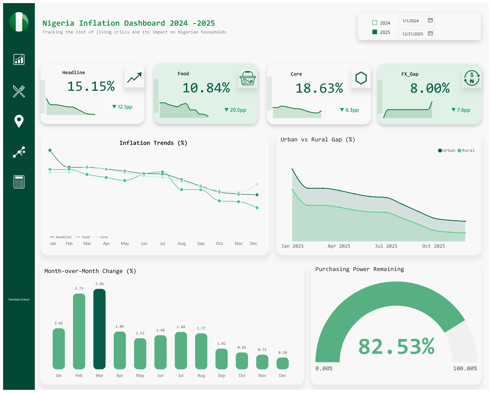
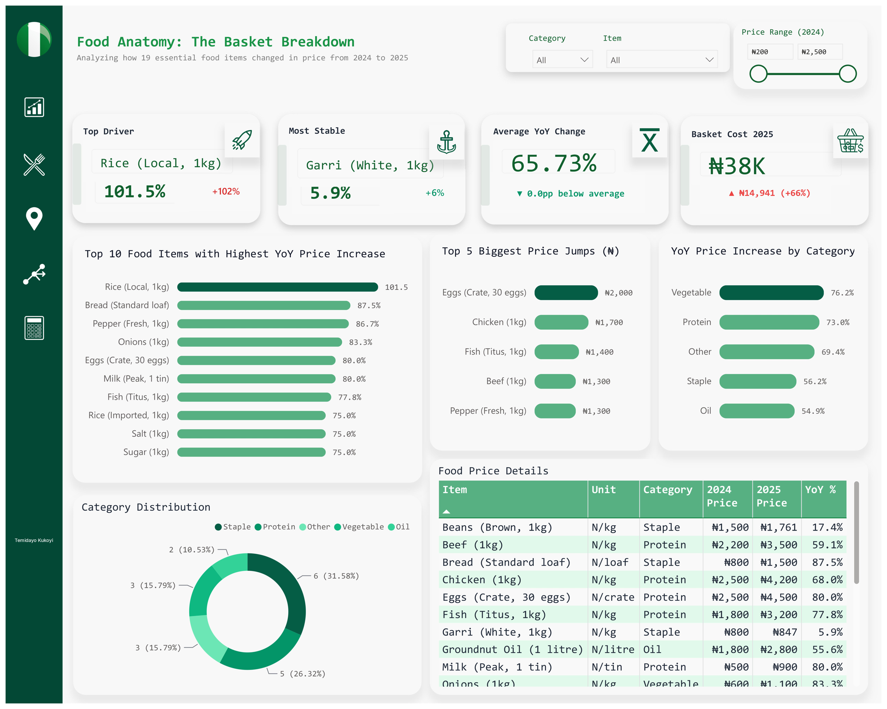
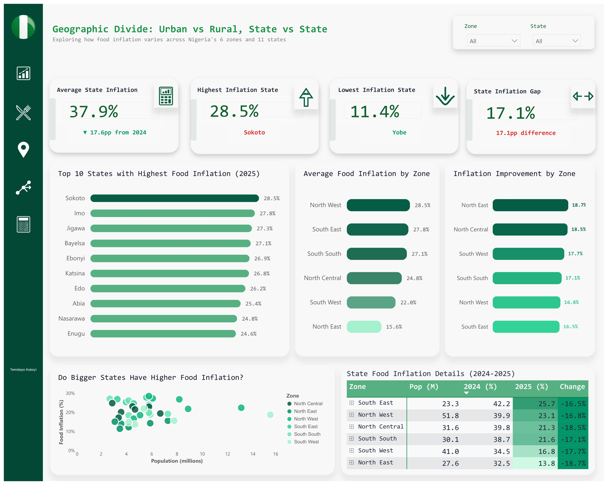
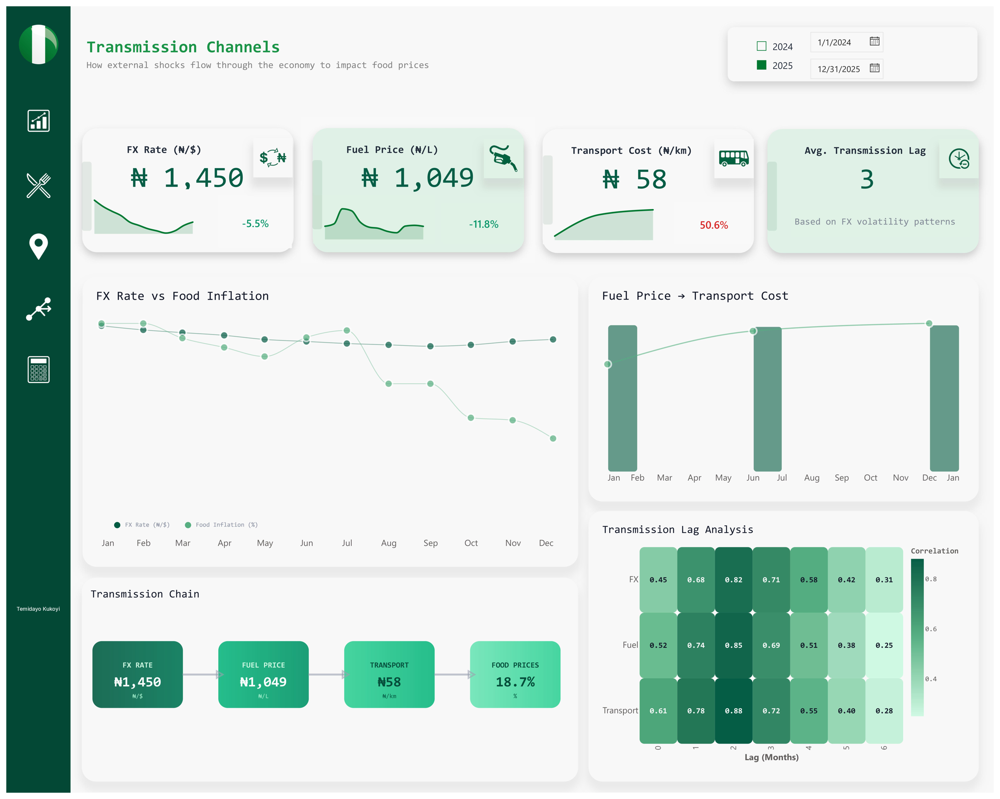
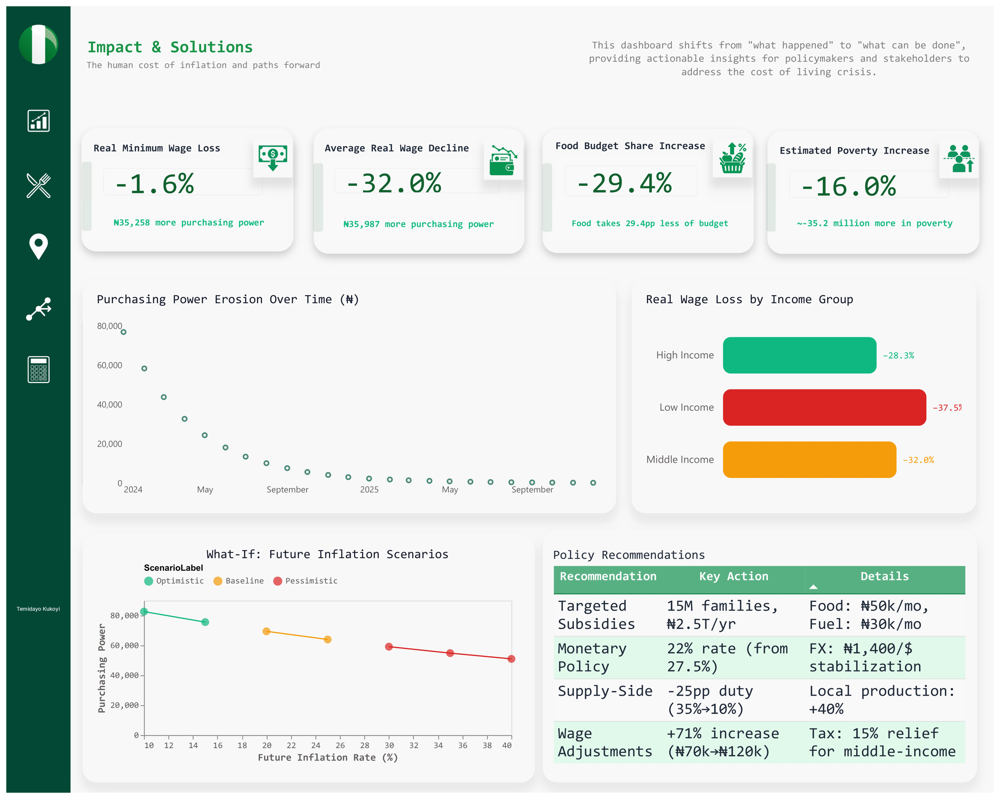
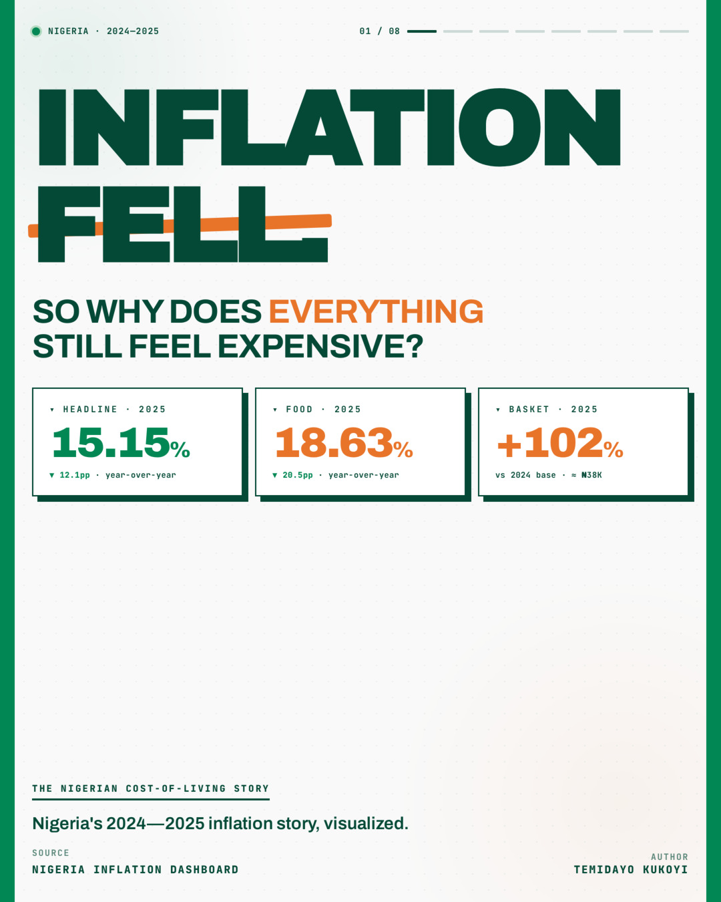
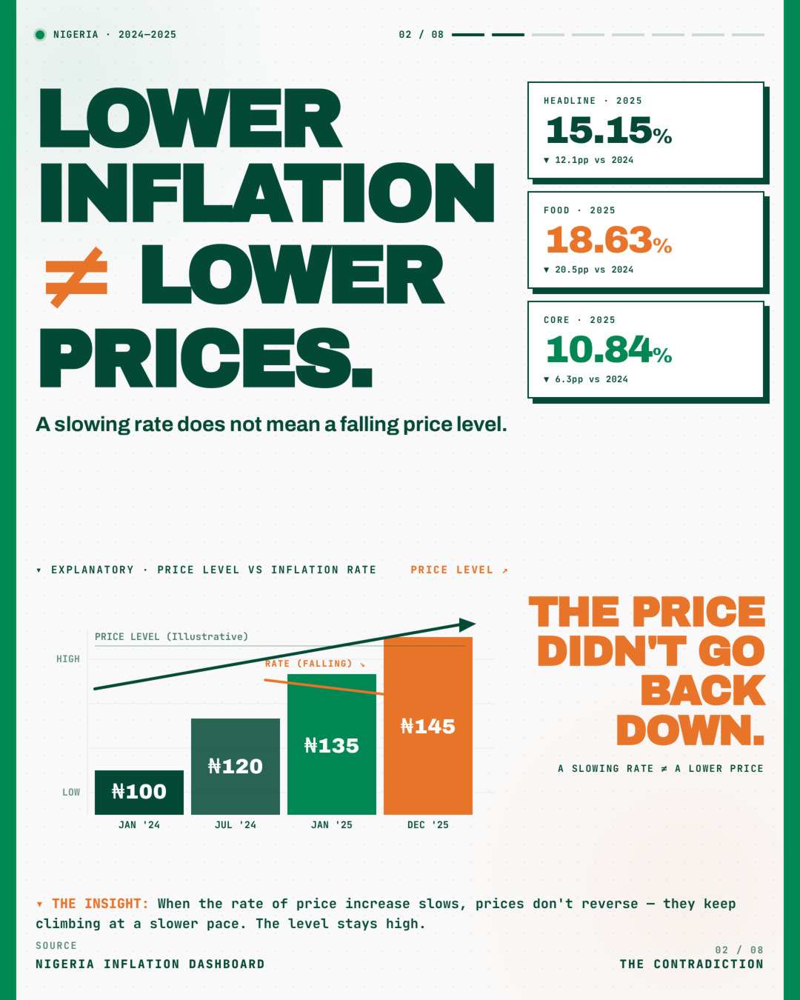
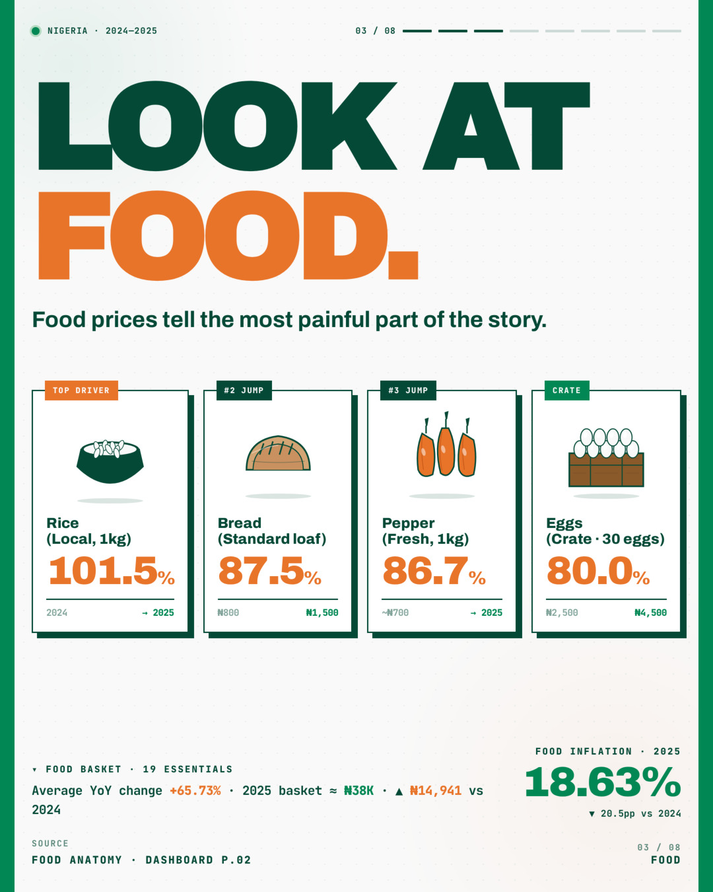
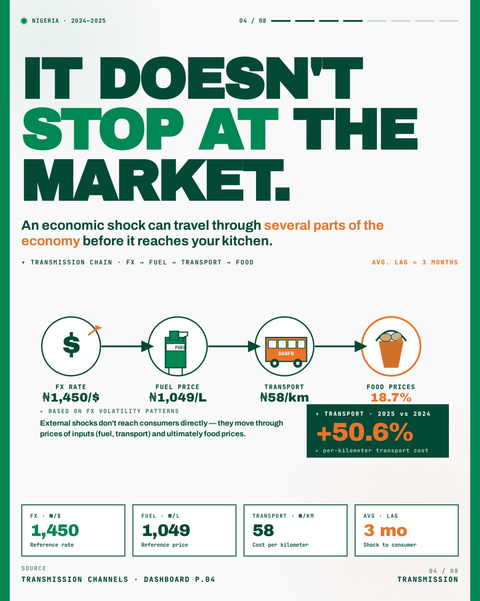

# Nigeria's 2024-2025 Inflation Story Visualized

**Tracking the cost of living crisis and its impact on Nigerian households**

An interactive data story exploring Nigeria’s 2024–2025 inflation story, from food prices and regional disparities to purchasing power, transmission channels and the human cost of rising prices.

| | |
|---|---|
| **Field** | Economic Analytics |
| **Period** | 2024–2025 |
| **Tools** | Power BI, Microsoft Excel |
| **Full case study** | [temidayokukoyi.vercel.app/work/nigeria-inflation-dashboard](https://temidayokukoyi.vercel.app/work/nigeria-inflation-dashboard) |

## The question

What is Nigeria's inflation story really telling us about the cost of living and what is it doing to people?

## Objective

To build a visual, data-driven view of Nigeria's 2024-2025 inflation that connects official headline inflation to everyday pressures - food costs, regional gaps, transmission channels, and purchasing power.

## Context

Nigeria's 2024-2025 inflation cannot be understood through a single headline number. In January 2025, NBS rebased the CPI to 2024=100 and changed the weightings, which is why headline fell sharply to 15.15% in December 2025. That December YoY number is a point-in-time snapshot after rebasing.

Households did not experience a point-in-time snapshot. They experienced 12 months of cumulative pressure from food, exchange rates, fuel, transport, and regional shocks. This project connects both layers: the official NBS December YoY for headline comparability, and a full-year market analysis Jan-Dec 2025 to show what households actually felt on average.

## The data

2024-2025 Nigeria headline, food-price, regional, exchange-rate, fuel, transport and household-impact data across 5 dashboard views.

## Data sources

- National Bureau of Statistics (NBS) CPI Report December 2025 - for headline 15.15%, food 10.84%, core 18.63% Dec YoY
- NBS Selected Food Price Watch January 2025 & May 2026 Excel - for national food price comparison
- Central Bank of Nigeria (CBN) - FX and MPR data
- FAO Food Price data and author market basket (19 items)
- Period: January 2024 - December 2025

## Method

Headline/Core/Food Dec figures (15.15% / 10.84% / 18.63%) = NBS Dec YoY point-in-time after rebasing. State averages (37.9% national avg, Sokoto 28.5% vs Yobe 11.4%) and basket metrics (65.73% avg food rise, ₦38K basket, +₦14,941 / +66%, Rice 101.5%) = Author's calculation - full-year average Jan-Dec 2025 from 19-item market survey. Full-year averages are naturally higher than December-only because they include the mid-year peaks (March MoM 3.96%). The 12.1pp drop in headline is versus Dec 2024 old base.

## Analysis process

SOURCE → CLEAN → ANALYZE → VISUALIZE → COMMUNICATE

The analysis combines: trend analysis, year-over-year and month-over-month, regional comparison by state and geo-political zone, food-price basket analysis by category (vegetable 76.2%, protein 73.0%, staple 56.2%, oil 54.9%), purchasing-power erosion, and correlation/lag analysis across FX, fuel, transport and food.

Headline → Food Anatomy → Geographic Divide → Transmission Channels → Impact & Solutions. The visual narrative moves from "what happened" to "why it matters to a household.

## What the data showed

### 15.15% — Headline inflation eased to 15.15% in Dec 2025 view

Nigeria's headline inflation printed 15.15% YoY in Dec 2025, down 12.1pp from the comparison period and down 19.65pp from 34.80% in Dec 2024 on old base. Month-on-Month peaked at 3.96% in March and eased to 0.54% in Dec. CPI index stood at ∼146.3. Purchasing power remaining was 82.53%, meaning ₦100 in Jan 2024 bought only ₦82.53 worth by Dec 2025.

### 10.84% Food / 18.63% Core — Food eased officially, but core stayed sticky - pressure didn't disappear

Food inflation was 10.84% YoY in Dec 2025, down 20.5pp from 39.84% in Dec 2024. Core inflation (all items less farm produce and energy) was 18.63% YoY, down only 6.3pp. This split is critical: lower headline did not mean cheaper food for households, it meant food inflation slowed while non-food pressures - transport +50.6% to ₦58, housing, energy - stayed high. This corrects the previous label where core was mislabeled as food.

### 28.5% vs 11.4% - Gap 17.1pp — A wide regional divide in what households paid

On a full-year average basis Jan-Dec 2025, Sokoto recorded the highest state food inflation at 28.5%, Yobe the lowest at 11.4%, a 17.1pp gap. Average state inflation across all states was 37.9%. By zone: North West 28.5% highest, South East 27.8%, South South 27.1%, North Central 24.8%, South West 22.6%, North East 15.6% lowest. North East improved most vs 2024 at -18.7pp. This full-year view differs from NBS December-only state ranking and shows where the yearly pain was concentrated.

### -32.0% real wage / 29.4pp food budget — Purchasing power was still under pressure despite lower headline

The impact dashboard shows average real wage decline of -32.0%, equivalent to ₦35,987 loss in purchasing power. Low-income households were hit hardest at -37.5%, middle -32.0%, high-income -28.3%. Food budget share increased by 29.4 percentage points. Real minimum wage analysis shows need for ₦5,258 more just to maintain 2024 level. Estimated poverty impact +16% (∼35.2 million more). This explains why disinflation did not feel like relief at the market.

### 101.5% — Rice recorded biggest jump in this dashboard's basket

In this dashboard's 19-item 2024-2025 market basket comparison, Local Rice 1kg recorded 101.5% increase - the largest in this sample. Bread standard loaf 87.5%, Fresh Pepper 86.7%, Onions 83.3%, Eggs crate 80.0%, Milk Peak tin 80.0%, Fish Titus 77.8%. Most stable: Garri White 5.9%. Biggest Naira jumps: Eggs +₦2,000, Chicken +₦1,700, Fish Titus +₦1,400. By category: Vegetables 76.2%, Protein 73.0%. Nationally per NBS Selected Food Price Watch Jan 2024 vs Jan 2025, Brown Beans led at +151.75% (₦976.58 to ₦2,458.53). Difference is due to sample/market. In this 19-item basket tracked from 2024-2025, Local Rice rose 101.5% - the largest among the 19 items. Other high rises: Bread 87.5%, Pepper 86.7%. Garri White was most stable at 5.9%. Nationally, NBS reports Brown Beans rose 151.75% in Jan YoY because NBS uses a larger national sample and a single-month snapshot. Both figures are correct for their different samples.

### 3 months lag / 0.88 correlation — Price pressures moved through the economy with a lag

Transmission analysis shows average lag of ∼3 months between external cost pressures and food prices. Fuel price averaged ₦1,049 (-11.8% YoY), FX ₦1,450 (-5.5%), FX gap 8.00% (-7.6pp), yet transport cost rose +50.6% to ₦58. Correlation strongest at 2-month lag: transport→food 0.88. This lag means policy changes in FX/fuel take a quarter to show in food prices, and explains why March MoM spiked after February fuel/FX moves. When fuel or exchange rates move, food prices don't change the same day. This analysis shows it takes about 3 months for the pressure to travel through transport costs into food prices. Strongest link was transport to food with 0.88 correlation at 2 months - meaning when transport went up 50.6% to ₦58, food followed shortly after.

## Challenges

The main challenge in 2025 was NBS rebasing. After rebasing, Dec YoY headline looked low at 15.15% while market prices remained high. The dashboard had to show both: the official easing and the lived experience of higher basket costs, to avoid reducing the story to a single figure.

## Recommendations

1. HELP HOUSEHOLDS DIRECTLY - Targeted Support
The data shows low-income lost -37.5% real wage vs -28.3% for high-income.
- Give 15 million vulnerable families direct help: ₦2.5 Trillion per year budget
- Food voucher: ₦50,000 monthly to cover that ₦14,941 basket increase (+66% to ₦38k)
- Fuel support: ₦30,000 monthly to cushion transport cost still at ₦58 (+50.6%)
- Why: Food budget share up 29.4pp, so families need cash, not just lower headline 15.15%

2. STABILIZE THE MONEY - Monetary & FX
The data shows FX averaged ₦1,450 (-5.5% YoY) but FX gap still 8.00%.
- Cut MPR from 27.5% to 22% - because core 18.63% shows pressure easing but still high
- Stabilize Dollar at ₦1,400, reduce FX gap from 8% to 3% 
- Why: 3-month lag means if we stabilize today, food will ease in 3 months

3. FIX SUPPLY - Make food available
Vegetables up 76.2%, Protein up 73.0% - supply is the problem.
- Cut import duty on food inputs from 35% to 10% - that's -25 percentage points
- Increase local production by +40% for rice, beans, pepper
- Build storage to cut post-harvest loss from 40% to 15%
- Why: Garri White only up 5.9% - locally produced and stored well, so it stayed stable

4. ADJUST WAGES - So people can afford it
Real wage down -32.0% average = ₦35,987 loss in purchasing power.
- Raise minimum wage by +71% from ₦70k to ₦120k - to cover the -32% loss + ₦5,258 extra needed
- Give middle-income 15% tax relief - they lost -32.0% and need buffer
- Why: Headline says 15.15% but basket says ₦38k, so wage must match basket, not headline

## Outcome

**What came out of it**
A 5-view interactive Power BI dashboard and 8-page visual report that takes a reader from headline to household: national trend (Page 1), food anatomy (Page 2), state-by-state differences (Page 3), transmission channels (Page 4), and purchasing power impact (Page 5).

What it changed about the picture
Headline improved to 15.15% Dec YoY, 12.1pp down. But the dashboard shows why that was not relief: Core was still 18.63%, food budget share was up 29.4pp, real wages down 32.0% on average, basket cost up to ₦38k (+66%), local rice up 101.5% in this basket (beans up 151.75% nationally per NBS), and full-year state gap was 17.1pp between Sokoto 28.5% and Yobe 11.4%. External pressures transmitted with ∼3-month lag.

**What it supports**
Anyone weighing household support, wage reviews, or supply-side interventions can see which lever maps to which pressure, and where in the country it bites hardest, instead of reacting to a single national figure.

**Status**
Independent analysis built on published NBS, CBN, FAO and author market survey; not commissioned. Methodology distinguishes NBS Dec YoY point-in-time (new base) from author's full-year average. With a real stakeholder, next step would be monthly refresh and state-level alert view.

## In this repository

- `report/Nigeria-2024-2025-Inflation-Report.pdf` — written report / dashboard export (PDF).
- `report/Nigeria-2024-2025-Inflation-Dashboard.pdf` — written report / dashboard export (PDF).
- `figures/` — 13 dashboard and report screenshots.

## Gallery

_…and 4 more in `figures/`._

## Skills applied

Data Analysis, Data Visualization, Statistical Analysis, Data Storytelling, Dashboard Design

---

**Temidayo Kukoyi** · Data analyst · [temidayokukoyi.vercel.app](https://temidayokukoyi.vercel.app) · [LinkedIn](https://www.linkedin.com/in/temidayo-kukoyi-5a59a7353)
